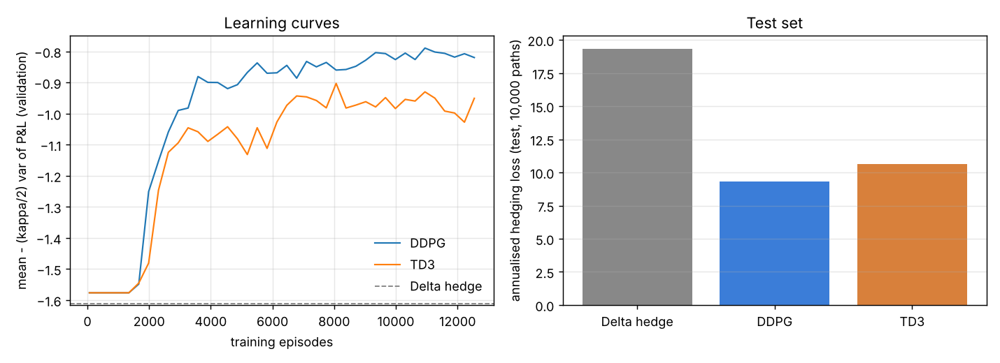

# deep-bellman-hedging

Reinforcement-learning option hedging in PyTorch. A **DDPG** agent and a **TD3** agent learn to hedge a short option book on **two correlated Heston underlyings**. Both trade under **proportional transaction costs, quadratic market impact, a per-step trade limit and a gross-notional budget**. They are scored against Black-Scholes delta hedging on 10,000 fresh simulated paths.



## Setup

- **Market** (`market.py`). Two underlyings with Heston stochastic volatility (κ = 2, θ = 0.04, ξ = 0.5, ρ = −0.7 to their own variance, 0.5 to each other), discretised daily with full-truncation Euler. There's no options data feed here, so all paths are simulated.
- **Book.** Short one 1-month at-the-money call on each underlying, with the premium received up front. The liability is marked daily at Black-Scholes using the current Heston volatility.
- **Frictions and constraints** (`env.py`). Each step's requested holdings pass through one constraint layer, shared by every strategy including delta hedging:
  - a trade limit of at most 0.25 shares per asset per step (liquidity),
  - holdings between 0 and 1.5 shares,
  - gross hedge notional capped at the initial value of the underlyings (budget), with positions scaled down if over.

  Trades pay 10 bp of notional plus an impact cost of 0.02 × shares² × price.
- **Objective.** The per-step reward is `dW − (κ/2)·dW²` with κ = 0.3, a mean-variance criterion on wealth changes. Terminal wealth is the hedging P&L.
- **Agents** (`agents.py`). The actor outputs **BS delta plus a bounded learned adjustment** (tanh, ±0.5 shares), so an untrained agent already hedges like delta. Critics get 3,000 warm-up updates before the actor starts moving. TD3 adds twin critics, delayed actor updates and target-policy smoothing. The replay buffer stores the executed, constraint-projected action.
- **Training** (`train.py`). 12,800 episodes per agent, run 64 at a time on fresh paths. The buffer is warmed up with noisy delta-hedge trajectories, and 6 gradient updates run per environment step. The kept actor is the best checkpoint on a separate validation path set (seed 999). The final test uses another 10,000 paths (seed 12345).

## Results (test set, 10,000 paths)

| Strategy | Mean P&L | Std P&L | CVaR 95% loss | Mean trading cost | Annualised hedging loss | vs delta |
| --- | --- | --- | --- | --- | --- | --- |
| No hedge | 0.04 | 5.01 | 13.07 | 0.00 | 44.57 | +130.5% |
| Delta hedge | −1.41 | 1.16 | 4.17 | 1.51 | 19.34 | baseline |
| **DDPG** | −0.40 | 1.58 | 4.05 | 0.50 | **9.29** | **−51.9%** |
| TD3 | −0.49 | 1.62 | 4.29 | 0.59 | 10.64 | −45.0% |

Annualised hedging loss is the negative mean-variance score of one month's P&L, `−(mean − κ/2 · var)`, times 12 monthly rolls. Units are currency per contract, with spot at 100.

What the agents learned: under these frictions, delta hedging spends 1.51 per episode on trading costs. Both agents trade about a third as much, accepting slightly wider P&L dispersion (std 1.6 vs 1.2) for a much better mean. Tail risk stays about the same as delta: DDPG's CVaR is slightly lower, TD3's slightly higher. In this setup TD3 didn't beat DDPG. Its validation curve was noisier and peaked earlier.

## Run

```
pip install -e ".[test]"
pytest -q
python -m hedging.train --episodes 12800   # about 4 minutes on 2 CPU cores
python -m hedging.plot
```
